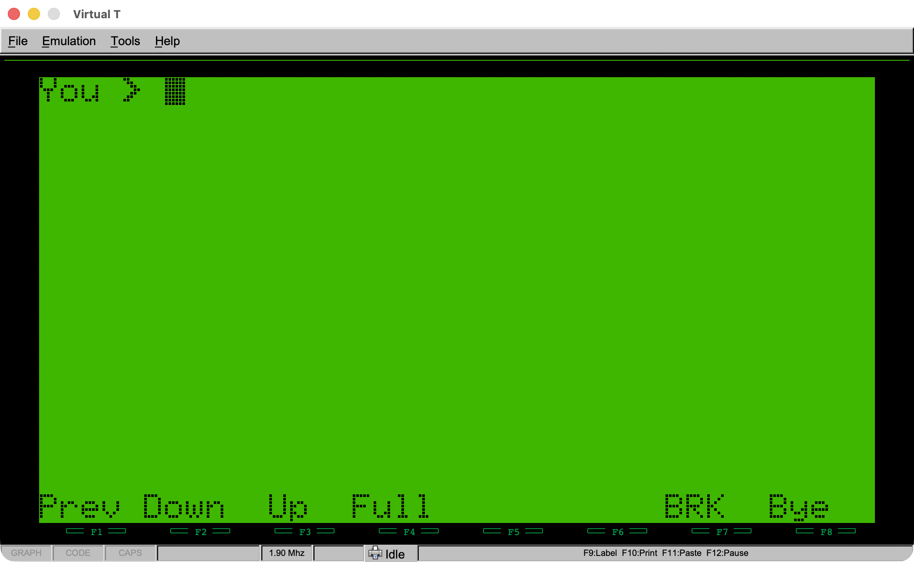
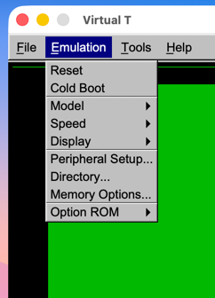

# Overlord Tandy

Since Sam Altman is stealing all our RAM, we built an AI agent to run on a Tandy 200 from 1984 -- a system with 40 KB of RAM!

## Tellcom Version

```sh
python3 -m pip install -r requirements.txt
python3 overlord_tandy.py
```

The program reads the first `openai`-type endpoint with a `choice-model` from
`/home/$USER/ai_apis.json` on Linux or `/Users/$USER/ai_apis.json` on macOS, then connects to `/dev/ttyUSB0` at 1200 baud.

To run it directly in your local terminal instead, use:

```sh
python3 overlord_tandy.py --cli
```

### Commands
- `/new`: Clear the conversation history and start a new chat
- `/help`: Shows commands
- `/quit`: Exit the program

## Native Tandy Version

```sh
python3 -m pip install -r requirements.txt
python3 tclient/overlord_tandy.py
```

The program reads the first `openai`-type endpoint with a `choice-model` from
`/home/$USER/ai_apis.json` on Linux or `/Users/$USER/ai_apis.json` on macOS, then connects to `/dev/ttyUSB0` at 9600 baud.

### Commands
- `/new`: Clear the conversation history and start a new chat
- `/help`: Shows commands

### Tandy Setup

Use `updo.py` under `tclient/tools` to upload the Native client to the Tandy, the usage is: `python updo.py ../text-basic/tb.do /dev/ttyUSB0`. 
 * Where `/dev/ttyUSB9` is the COM port of the tandy.

* Use TELCOM press F4
* Setup the STAT line, press F3 then type 881NDNN, press enter
* Then F2 to download, name it `tb`

* Press F8 to go to menu, then go to BASIC
* Type run "tb"

### Using an emulator

Use VirtualT to run Overlord Tandy in an emulator of the Tandy 200.

You need to set-up a loopback using `socat` which you can install with your fav package manager, then run:
 * macOS `socat -d -d pty,raw,echo=0,link=/tmp/ttyUSB9 pty,raw,echo=0,link=/tmp/ttyV1`
 * Linux `socat -d -d pty,raw,echo=0,link=/dev/ttyUSB9 pty,raw,echo=0,link=/dev/ttyV1`

Install [VirtualT](https://github.com/usymmij/VirtualT) and build from source, you also need `fltk` which you can install with your fav package manager.

Use the following settings, where host port is one of the links above:



